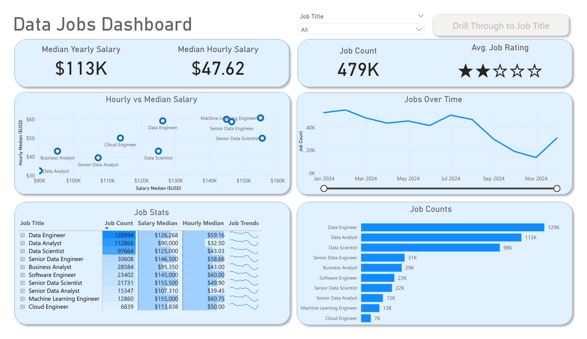

# Data Jobs Market Intelligence

A Power BI dashboard and Python analysis exploring job roles, advertised salaries, skills and remote-work signals in a job-posting dataset. The aim is to help a reader compare the opportunities represented by this dataset and ask better questions about career options.



## Review the evidence

- [Dashboard PDF](dashboard/Data_Jobs_Dashboard.pdf) for a quick walkthrough
- [Power BI source](dashboard/Data_Jobs_Dashboard.pbix)
- [Python analysis](src/analyze_jobs.py)
- [Data dictionary](docs/data_dictionary.md) and [summary tables](insights)

The two dashboard pages cover an executive overview and job-title drill-through. The repository contains the PBIX and exported previews; a live Power BI Service deployment is not provided.

## Findings and scope

The committed role summary totals **52,924 postings**. Weighting its remote-work proportions by role counts gives approximately **13.8% remote**. These checks validate the supplied summaries internally; they do not independently verify the missing source workbook.

Data Engineer, Data Analyst and Data Scientist are the three largest role groups in the saved summary. Python and SQL lead the saved skills counts. Salary fields are described as **USD** in the data dictionary; country comparisons should not be interpreted as local-currency pay or representative market salaries. Salary medians cover records with reported values, not every posting.

The dictionary describes the source as an apparent monthly slice. The original collection method, licence and exact source coverage need confirmation. These findings are not a current or complete labour-market estimate. Absence of an explicit degree mention does not prove that a role has no degree requirement.

## How it works

The script reads an Excel workbook, parses skill-list strings with `ast.literal_eval`, groups records by role and country, counts skills and writes five summary CSV files. Country summaries retain groups with at least 200 postings; skill-salary summaries retain skills with at least 500 occurrences. The `_pct` columns store proportions from 0 to 1.

## Setup and execution

From the repository root, create and activate a Python virtual environment, then:

```bash
python -m pip install -r requirements.txt
```

**The required `data/job_postings_monthly.xlsx` workbook is not included.** Obtain an authorised copy of the original workbook and place it at that exact path before running:

```bash
python src/analyze_jobs.py
```

This command overwrites the five CSVs in `insights/`; preserve a copy if comparing with the committed results. Required fields are listed in the data dictionary. No substitute data has been created. No API credentials are required.

Power BI Desktop is required to open and refresh the PBIX. Its source connection must be checked against your authorised local dataset. The dashboard was not refreshed in the October 2026 review.

## Tests

Parser regression tests use the Python standard library test runner and pandas; no extra test dependency is required:

```bash
python -m unittest discover -s tests -v
```

The five test methods check existing lists, normalised string lists, missing values, malformed/non-list inputs and non-execution of code-like text. They exposed the original list-handling error before the fix and pass after it. Existing Python lists are preserved; serialised lists retain the original trimming and lowercasing behaviour.

## Limitations and next steps

End-to-end analysis cannot be reproduced without the source workbook. Tests cover parsing and the no-qualifying-skills case, not dashboard refresh or every aggregation edge case. If no skill reaches the 500-occurrence threshold, the skill-salary CSV contains its headers but no data rows. Repeated skills within one posting are counted as occurrences by the current script.

Next steps are to confirm source provenance and permitted access, validate missingness and duplicate postings, and reproduce the dashboard against that verified source. No licence or sharing permissions have been changed.
