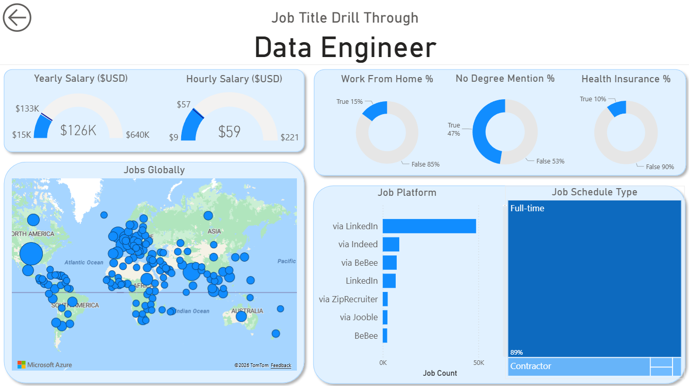

# Data Jobs Market Intelligence Dashboard

A portfolio-ready analytics project that combines **Power BI**, **Python**, and a real-world dataset of **52,924 job postings** to analyze demand, salaries, remote work, degree requirements, and skills across the data job market.


## Why this project stands out

Most portfolio dashboards stop at charts. This repository goes further:
- frames a clear business question,
- documents the dataset,
- includes reproducible analysis code,
- surfaces recruiter-friendly insights,
- and packages the Power BI dashboard with supporting assets.

This makes the project much stronger for **Data Analyst**, **Business Intelligence**, and **Junior Analytics Engineer** applications.

## Business question

**What can job seekers learn from job postings about demand, salaries, remote work, and skills in the data job market?**

## Project assets

- `dashboard/Data_Jobs_Dashboard.pbix` — Power BI dashboard source file
- `dashboard/Data_Jobs_Dashboard.pdf` — exported dashboard preview
- `data/job_postings_monthly.xlsx` — source dataset
- `src/analyze_jobs.py` — reproducible Python analysis
- `insights/*.csv` — precomputed summaries for quick review
- `docs/data_dictionary.md` — column definitions and caveats

## Tools used

- **Power BI** for dashboarding and drill-through experience
- **Python (pandas/openpyxl)** for data cleaning and feature extraction
- **Excel dataset** with salary, geography, source platform, and skills fields

## Key findings

### 1) Demand is concentrated in a few roles
The most common roles in the dataset are:
| job_title_short      |   job_count |
|:---------------------|------------:|
| Data Engineer        |       14060 |
| Data Analyst         |       12328 |
| Data Scientist       |       11422 |
| Senior Data Engineer |        3161 |
| Business Analyst     |        3083 |

### 2) Senior data roles command the highest pay
By median annual salary:
| job_title_short           |   median_year_salary |
|:--------------------------|---------------------:|
| Senior Data Engineer      |               153500 |
| Senior Data Scientist     |               150000 |
| Data Engineer             |               121650 |
| Machine Learning Engineer |               116250 |
| Data Scientist            |               115000 |

### 3) Remote work exists, but it is not the majority
- Remote postings: **13.8%**
- Postings without an explicit degree mention: **34.4%**
- Postings mentioning health insurance: **11.6%**

### 4) Core tools dominate the market
Top extracted skills:
| skill    |   job_count |
|:---------|------------:|
| python   |       26646 |
| sql      |       26229 |
| aws      |       10534 |
| azure    |        9964 |
| tableau  |        8192 |
| spark    |        8045 |
| r        |        8008 |
| excel    |        7705 |
| power bi |        6796 |
| java     |        5831 |

### 5) Geography matters
Top countries by posting count (filtered to countries with at least 200 postings):
| job_country    |   job_count |   median_year_salary |
|:---------------|------------:|---------------------:|
| United States  |       14561 |             100000   |
| United Kingdom |        4281 |              90000   |
| India          |        4133 |             122900   |
| France         |        2597 |              90000   |
| Germany        |        2354 |              86400   |
| Sudan          |        1823 |             121500   |
| Singapore      |        1575 |              65241.5 |
| Canada         |        1572 |             108416   |
| Netherlands    |        1392 |             117750   |
| Spain          |        1267 |             112430   |

## Dashboard walkthrough

### Page 1 — Executive overview


This page answers:
- Which roles have the most demand?
- Which roles pay the most?
- How do annual and hourly compensation compare?
- What does the posting trend look like?

### Page 2 — Job title drill-through


This drill-through page turns the dashboard into a decision tool by showing, for a selected role:
- annual and hourly salary range,
- remote work rate,
- degree requirement signal,
- health insurance signal,
- job platform mix,
- schedule type split.

## What makes this project hireable

This project demonstrates:
- dashboard design and interaction design,
- business framing and insight prioritization,
- structured documentation,
- reproducible analytics with Python,
- comfort working with semi-structured skill data.

Instead of presenting “just a dashboard,” it shows an end-to-end workflow: **dataset → transformation → insight generation → decision-ready dashboard**.

## Suggested talking points for interviews

Use these when discussing the project:

1. **Data modeling:** I combined structured salary fields with semi-structured skills fields and built summary views by role, geography, and skill.
2. **Analytical thinking:** I focused on questions job seekers actually care about: demand, pay, remote availability, and entry barriers.
3. **Dashboard design:** I used drill-through to let a user move from market-level trends into role-level evaluation.
4. **Iteration mindset:** I identified weak visuals and packaged the project so it reads clearly on GitHub without needing recruiters to open Power BI.

## How to run the analysis

```bash
pip install -r requirements.txt
python src/analyze_jobs.py
```

The script regenerates summary files in `insights/`.

## Recommended next improvements

- Add a dedicated **skills analysis page** in Power BI
- Flatten `job_type_skills` to compare skill categories, not only raw skills
- Add **salary drivers** analysis for remote vs non-remote roles
- Improve geographic analysis with a cleaned country-level view
- Publish an interactive version with Power BI Service screenshots or a short demo video

## Portfolio positioning

Use this title on GitHub and LinkedIn:

**Data Jobs Market Intelligence: Salaries, Skills, and Hiring Trends in Power BI**

## Repository structure

```text
data-jobs-market-intelligence/
├── assets/
├── dashboard/
├── data/
├── docs/
├── insights/
├── src/
├── .gitignore
├── README.md
└── requirements.txt
```

## License

Add your preferred open-source license before publishing.
